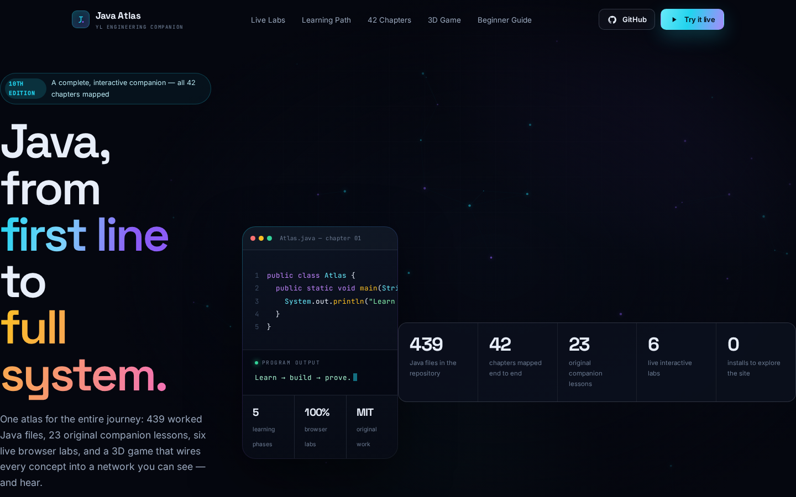
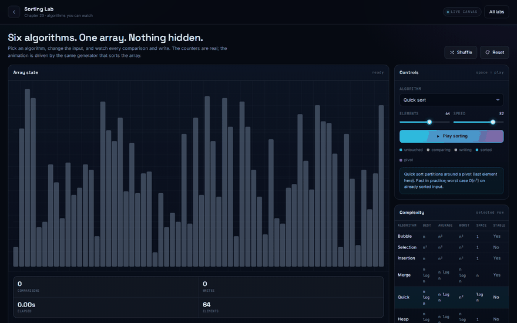
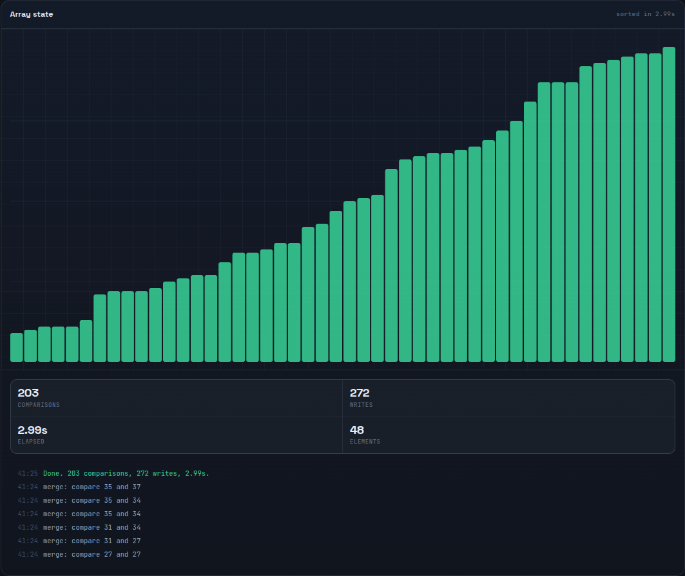
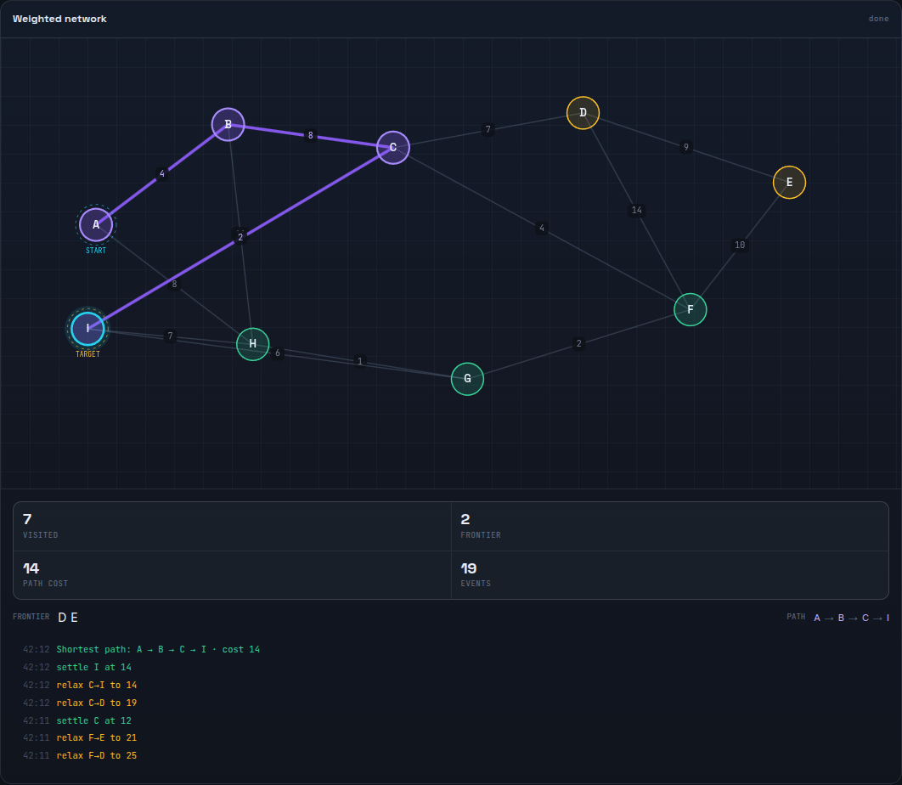
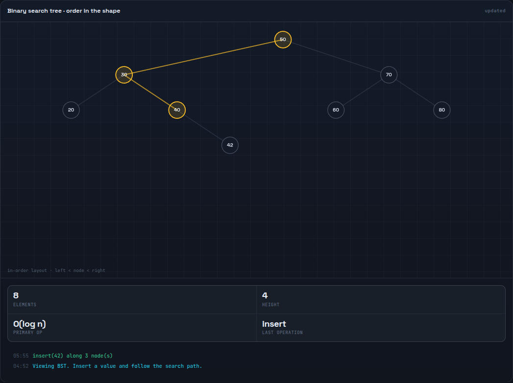
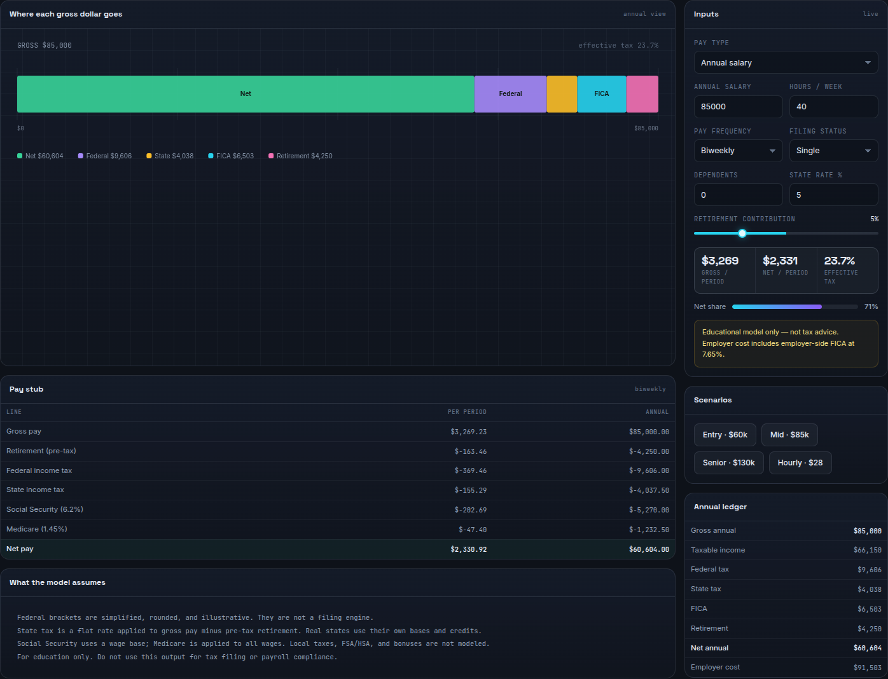
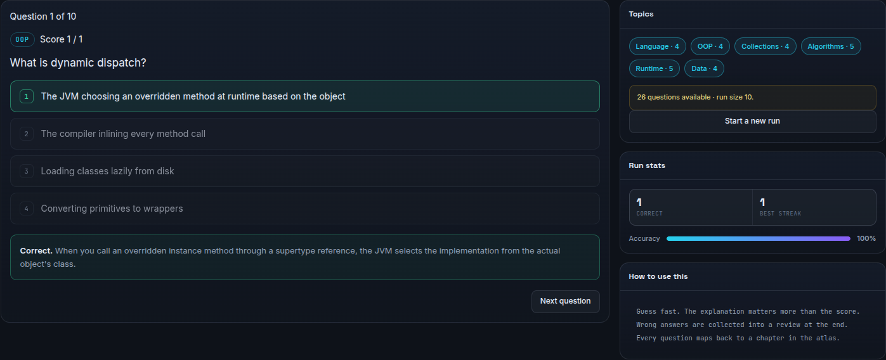
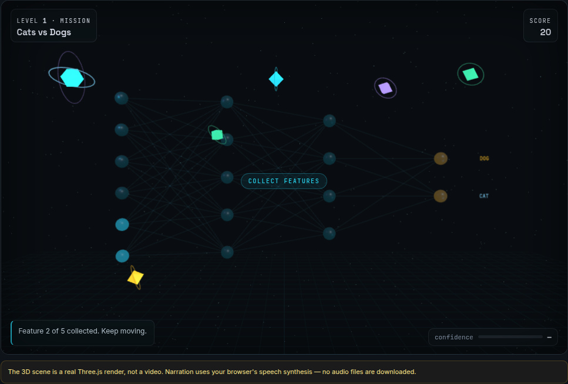

<div align="center">

# Java Atlas

### From first line to full system — an interactive companion to all 42 chapters

[](https://m0-ar.github.io/YL/)
[](https://github.com/M0-AR/YL/releases/tag/v1.0.0)
[](LICENSE)
[](companion/java/pom.xml)
[](#the-42-chapter-atlas)
[](https://m0-ar.github.io/YL/labs.html)

**[Open the live atlas](https://m0-ar.github.io/YL/)** ·
**[Preview page](https://m0-ar.github.io/YL/preview.html)** ·
**[Release v1.0.0](https://github.com/M0-AR/YL/releases/tag/v1.0.0)** ·
**[Beginner guide](#-beginner-guide--read-this-and-you-are-a-professional)** ·
**[Companion lessons](companion/README.md)** ·
**[All labs](https://m0-ar.github.io/YL/labs.html)**



</div>

---

## Why this repository exists

Most exercise repositories are a pile of files with a chapter number on top. This one is a map.

Java Atlas is an independent study companion built around the topic sequence of **Y. Daniel Liang's _Introduction to Java Programming, Comprehensive Version_ (10th Edition)**. It brings three kinds of material into one place:

- **439 Java files** organized by chapter, from elementary programming to graphs and database connectivity.
- **23 original lessons** for the chapters that do not have worked code here. Each lesson explains the idea in plain language, shows a worked example, and ends with a practice task and a checkpoint.
- **Six interactive browser labs** — sorting, graph traversal, data structures, payroll, a quiz, and a 3D game — that run with no installation and make abstract ideas visible.

The result is a complete 42-chapter route through Java: read the idea, run the code, move the controls, break the algorithm, and watch what happens.

### What this repository is not

This is **not** the textbook, and it does not contain or redistribute the book's chapter text, figures, or exercise statements. Chapter numbers are used only to map topics. Every companion lesson is original prose written for this project. The textbook remains the work of its author and publisher.

The original chapter files are student work with varying style and completeness. The `companion/java` project is the clean, compiled, tested reference implementation. Both are useful: the first shows how many ways a problem can be solved, the second shows one disciplined way to structure the solution.

---

## Start here in 60 seconds

| If you want to… | Go here |
| :--- | :--- |
| See what this is without installing anything | **[Live atlas](https://m0-ar.github.io/YL/)** |
| Learn Java from zero | **[Beginner guide](#-beginner-guide--read-this-and-you-are-a-professional)** |
| Watch an algorithm instead of reading about it | **[Sorting lab](https://m0-ar.github.io/YL/labs/sorting.html)** |
| Find the material for one chapter | **[42-chapter atlas](#the-42-chapter-atlas)** |
| Run the tested examples | [`companion/java`](companion/java) |
| Understand the copyright boundary | **[Copyright and attribution](#copyright-and-attribution)** |

No build step, account, tracker, or package install is required for the site. Open a page and use it.

---

## What is inside

### Six browser labs

Each lab is a self-contained teaching instrument, not a video or a screenshot. Change the input, step through the algorithm, and read the explanation beside the result.



| Lab | What you can do | Open it |
| :--- | :--- | :--- |
| **Sorting** | Race insertion, selection, bubble, merge, quick, and heap sort. Compare comparisons, writes, and elapsed time. | [Live](https://m0-ar.github.io/YL/labs/sorting.html) · [Source](docs/labs/sorting.html) |
| **Graphs** | Drag nodes, pick a start and target, and step through BFS, DFS, and Dijkstra. Watch the frontier and the shortest-path tree change. | [Live](https://m0-ar.github.io/YL/labs/graph.html) · [Source](docs/labs/graph.html) |
| **Data structures** | Push, pop, enqueue, insert, search, and delete across a stack, queue, linked list, binary search tree, and hash table. | [Live](https://m0-ar.github.io/YL/labs/structures.html) · [Source](docs/labs/structures.html) |
| **Payroll** | Move salary, filing status, state, retirement, and dependents. See gross-to-net arithmetic break down line by line. | [Live](https://m0-ar.github.io/YL/labs/payroll.html) · [Source](docs/labs/payroll.html) |
| **Compiler Mind** | Answer ten questions from a 26-question pool. Get an explanation for every answer, then review what you missed. | [Live](https://m0-ar.github.io/YL/labs/quiz.html) · [Source](docs/labs/quiz.html) |
| **Neural Nexus** | Play a short 3D game: collect feature packets, train a forward pass, and watch a neural network grow. Narrated in the browser. | [Live](https://m0-ar.github.io/YL/labs/game.html) · [Source](docs/labs/game.html) |

| | | |
| :---: | :---: | :---: |
| [](https://m0-ar.github.io/YL/labs/sorting.html) | [](https://m0-ar.github.io/YL/labs/graph.html) | [](https://m0-ar.github.io/YL/labs/structures.html) |
| [](https://m0-ar.github.io/YL/labs/payroll.html) | [](https://m0-ar.github.io/YL/labs/quiz.html) | [](https://m0-ar.github.io/YL/labs/game.html) |

### The tested companion project

The `companion/java` project is a normal Maven module targeting **Java 17**. It contains small, focused implementations and JUnit 5 tests for the ideas that are easiest to get wrong:

- insertion, merge, and quick sort;
- a growable array list;
- a binary search tree;
- an AVL tree;
- a separate-chaining hash table;
- a left-leaning red-black tree;
- a weighted graph with Dijkstra's algorithm.

These are teaching implementations: readable first, optimized second. Each one has a `main` method you can run, and each core structure is exercised by tests.

---

## The 42-chapter atlas

**Code** means the chapter has worked files under `src/`. **Lesson** means the chapter has an original companion lesson with an explanation, example, practice task, and checkpoint. Together they cover all 42 chapters.

### Foundations — chapters 1–8

| Ch | Topic | Where to go |
| :---: | :--- | :--- |
| 01 | Introduction to Java | [Lesson](companion/foundations.md#chapter-1-how-java-runs) |
| 02 | Elementary Programming | [Code](src/Exercise_02) |
| 03 | Selections | [Code](src/Exercise_03) |
| 04 | Math, Characters, and Strings | [Code](src/Exercise_04) |
| 05 | Loops | [Code](src/Exercise_05) |
| 06 | Methods | [Code](src/Exercise_06) |
| 07 | Single-Dimensional Arrays | [Code](src/Exercise_07) |
| 08 | Multidimensional Arrays | [Code](src/Exercise_08) |

### Object-oriented design — chapters 9–13

| Ch | Topic | Where to go |
| :---: | :--- | :--- |
| 09 | Objects and Classes | [Code](src/Exercise_09) |
| 10 | Thinking in Objects | [Code](src/Exercise_10) |
| 11 | Inheritance and Polymorphism | [Code](src/Exercise_11) |
| 12 | Exception Handling and Text I/O | [Code](src/Exercise_12) |
| 13 | Abstract Classes and Interfaces | [Code](src/Exercise_13) |

### Interfaces and interaction — chapters 14–16

| Ch | Topic | Where to go |
| :---: | :--- | :--- |
| 14 | JavaFX Basics | [Code](src/Exercise_14) |
| 15 | Events and Animation | [Lesson](companion/foundations.md#chapter-15-events-and-animation) |
| 16 | JavaFX Controls, Layout, and Media | [Lesson](companion/foundations.md#chapter-16-controls-layout-and-media) |

### Algorithms and data structures — chapters 17–29

| Ch | Topic | Where to go |
| :---: | :--- | :--- |
| 17 | Binary I/O | [Code](src/Exercise_17) |
| 18 | Recursion | [Code](src/Exercise_18) |
| 19 | Generics | [Code](src/Exercise_19) |
| 20 | Lists, Stacks, Queues, and Priority Queues | [Code](src/Exercise_20) |
| 21 | Sets and Maps | [Lesson](companion/collections-algorithms.md#chapter-21-sets-and-maps) |
| 22 | Efficient Algorithms | [Lesson](companion/collections-algorithms.md#chapter-22-efficient-algorithms) |
| 23 | Sorting | [Lesson](companion/collections-algorithms.md#chapter-23-sorting) |
| 24 | Implementing Collections | [Lesson](companion/collections-algorithms.md#chapter-24-implementing-collections) |
| 25 | Binary Search Trees | [Lesson](companion/collections-algorithms.md#chapter-25-binary-search-trees) |
| 26 | AVL Trees | [Lesson](companion/collections-algorithms.md#chapter-26-avl-trees) |
| 27 | Hashing | [Lesson](companion/collections-algorithms.md#chapter-27-hashing) |
| 28 | Graphs | [Code](src/Exercise_28) |
| 29 | Weighted Graphs | [Lesson](companion/collections-algorithms.md#chapter-29-weighted-graphs) |

### Systems and professional practice — chapters 30–42

| Ch | Topic | Where to go |
| :---: | :--- | :--- |
| 30 | Multithreading and Parallelism | [Lesson](companion/enterprise.md#chapter-30-multithreading-and-parallelism) |
| 31 | Networking | [Lesson](companion/enterprise.md#chapter-31-networking) |
| 32 | JDBC | [Lesson](companion/enterprise.md#chapter-32-jdbc) |
| 33 | JavaServer Faces | [Lesson](companion/enterprise.md#chapter-33-javaserver-faces) |
| 34 | Advanced GUI | [Code](src/Exercise_34) |
| 35 | Advanced Database Programming | [Lesson](companion/enterprise.md#chapter-35-advanced-database-programming) |
| 36 | Internationalization | [Lesson](companion/enterprise.md#chapter-36-internationalization) |
| 37 | Servlets | [Lesson](companion/enterprise.md#chapter-37-servlets) |
| 38 | JavaServer Pages | [Lesson](companion/enterprise.md#chapter-38-javaserver-pages) |
| 39 | Web Services | [Lesson](companion/enterprise.md#chapter-39-web-services) |
| 40 | 2-4 Trees and B-Trees | [Lesson](companion/advanced-trees-testing.md#chapter-40-2-4-trees-and-b-trees) |
| 41 | Red-Black Trees | [Lesson](companion/advanced-trees-testing.md#chapter-41-red-black-trees) |
| 42 | Testing with JUnit | [Lesson](companion/advanced-trees-testing.md#chapter-42-testing-with-junit) |

---

<a id="-beginner-guide--read-this-and-you-are-a-professional"></a>
<a name="-beginner-guide--read-this-and-you-are-a-professional"></a>
## 🌱 Beginner Guide — Read this and you are a professional

This section assumes you have never written a program. It is also the section to reread when you feel lost. Nothing here requires a computer science degree. By the end, **you will know more than most interview candidates** — not because you memorized syntax, but because you can explain why the code works.

### 1. What Java actually is

A computer only understands instructions for its own processor. Java hides that fact behind three layers:

- **Source code** is what you write: `Atlas.java`.
- **Bytecode** is what the compiler produces: `Atlas.class`. It is a portable instruction set, not machine code.
- **The JVM** (Java Virtual Machine) reads bytecode and runs it on whatever computer you have.

Think of sheet music and a performer. The sheet music is the same everywhere; the performer adapts it to the instrument in the room. Bytecode is the sheet music, and the JVM is the performer.

The names around this are worth learning once:

| Name | What it is | When you need it |
| :--- | :--- | :--- |
| **JDK** | Java Development Kit: compiler, launcher, debugger, standard libraries | You are writing or running Java |
| **JRE** | Java Runtime Environment: the JVM plus libraries | You only run Java programs |
| **JVM** | The virtual machine that executes bytecode | It runs underneath everything |

Install a **JDK 17 or newer**. The vendor matters less than the version. If a course forces Java 8, the original chapter files will still compile, but the companion project expects Java 17.

### 2. Your first program, explained line by line

Create a file named exactly `Atlas.java`:

```java
public class Atlas {
    public static void main(String[] args) {
        String language = "Java";
        int chapters = 42;
        System.out.println(language + " in " + chapters + " chapters.");
    }
}
```

Compile and run it:

```bash
javac Atlas.java
java Atlas
```

What each part means:

- `public class Atlas` declares a class named `Atlas`. A public class must live in a file with the same name, including capitalization.
- `public static void main(String[] args)` is the entry point. `public` lets the launcher call it; `static` means no object is needed; `void` means it returns nothing; `String[] args` holds command-line arguments.
- `String language = "Java";` creates a variable that refers to text.
- `int chapters = 42;` creates a variable that holds a whole number.
- `System.out.println(...)` prints one line. `+` joins text and values.
- `java Atlas` names the **class**, not the file. Do not type `java Atlas.class`.

If you see `Error: Could not find or load main class`, the usual causes are a misspelled class name, a wrong package, or running from the wrong directory. If you see `class Atlas is public, should be declared in a file named Atlas.java`, the filename and class name disagree. These messages are instructions, not judgments.

### 3. How to use this repository without drowning

Do not open 439 files and start reading. Use the map:

1. **Pick one chapter.** Start at chapter 1 if you are new. Read the lesson first when one exists.
2. **Run one file.** Change one value. Break it on purpose. Read the error. Fix it. That loop teaches more than passive reading.
3. **Open the matching lab.** Move the controls until the idea feels mechanical rather than magical.
4. **Write the practice task from memory.** If you cannot, reread only the section you needed.
5. **Move on when you can explain the idea to someone else.** Not when you can recite syntax.

A useful rule: **one chapter, one runnable file, one lab, one written explanation**. That is a complete study session.

### 4. A ten-week route from zero to confident

This is a pace, not a race. Repeat a week if it has not clicked.

| Week | Chapters | Focus | Proof that you learned it |
| :---: | :--- | :--- | :--- |
| 1 | 1–4 | How Java runs, variables, decisions, strings | Write a program that reads three numbers and prints them in order |
| 2 | 5–8 | Loops, methods, arrays, matrices | Write a method that searches an array and explain its worst case |
| 3 | 9–11 | Classes, objects, inheritance, polymorphism | Model a small library with books and members |
| 4 | 12–13 | Exceptions, I/O, interfaces | Read a file, handle a missing file, and define an interface |
| 5 | 14–16 | JavaFX, events, controls | Build a window with one button and one event handler |
| 6 | 17–20 | Binary I/O, recursion, generics, collections | Write a recursive method and a generic pair class |
| 7 | 21–24 | Sets, maps, efficiency, sorting, custom collections | Compare two sorting algorithms with real timings |
| 8 | 25–27 | BSTs, AVL trees, hashing | Draw a tree after each insertion and explain each rotation |
| 9 | 28–33 | Graphs, concurrency, networking, JDBC | Find a shortest path; run two threads safely |
| 10 | 34–42 | Advanced GUI, databases, web, trees, testing | Write tests for one data structure you built |

The companion lessons link to tested code where the topic has one. When a lesson has no matching code file, write the example yourself. That is not a gap; it is the exercise.

### 5. Five beginner errors and what they actually mean

| Message | Plain meaning | First thing to check |
| :--- | :--- | :--- |
| `cannot find symbol` | The compiler does not know a name | Spelling, imports, and whether the variable is in scope |
| `missing return statement` | A non-void method can finish without returning a value | Every path through the method |
| `NullPointerException` | You tried to use a reference that points at nothing | Was the object actually created? |
| `ArrayIndexOutOfBoundsException` | The index is outside `0..length - 1` | Off-by-one in a loop or a hard-coded index |
| `incompatible types` | A value's type does not fit where it is being used | The declared type and the assignment |

Two habits prevent most of these: **compile often** and **print the value before you use it**. A five-second print is faster than a twenty-minute guess.

### 6. What "professional" means here

Professional is not a title. It is a set of habits you can start today:

- **Read the error before changing the code.** The message usually names the file, line, and symbol.
- **Make the smallest change that tests one idea.** If you change five things, you learn nothing when it works.
- **Name things for what they mean.** `remainingAttempts` beats `x`.
- **Write the test before you trust the implementation.** A program that prints the right answer once is not proven.
- **Know the cost of what you wrote.** A loop inside a loop is not automatically wrong, but you should know it is quadratic.
- **Keep secrets and personal data out of source files.** Configuration belongs outside the code.
- **Respect other people's work.** Use, quote, and attribute correctly. This repository does the same.

When you can do those seven things with a small program, you are already working like a professional. The rest is practice and scale.

### 7. Checkpoint before chapter 2

You are ready to move on when you can answer these without notes:

1. What does `javac` produce, and what runs it?
2. Why must a public class match its filename?
3. What is the difference between a compile-time error and a runtime exception?
4. What does an array index of `0` mean, and what is the last valid index?
5. Why does `System.out.println` need parentheses and a semicolon?

If any answer is fuzzy, reread only that part of chapter 1 and try again. Confusion is information; it tells you exactly where to look.

---

## Run the code

### Requirements

- **A JDK, version 17 or newer** for the companion project.
- **Maven 3.9+** for the tested companion project.
- **A browser** for the labs. That is the entire requirement for the site.
- **JavaFX** only if you want to run the original GUI exercises that use it. The companion examples avoid JavaFX so they compile with a plain JDK.

### Run one original chapter file

```bash
git clone https://github.com/M0-AR/YL.git
cd YL
javac -d out src/Exercise_03/_08/e308SortThreeIntegers.java
java -cp out Exercise_03._08.e308SortThreeIntegers
```

The `-d out` flag writes class files to an `out/` directory and keeps the source tree clean. The package name becomes the directory path, which is why the class is launched as `Exercise_03._08.e308SortThreeIntegers`.

### Run and test the companion project

```bash
cd companion/java
mvn test
mvn -q exec:java -Dexec.mainClass=atlas.collections.Sorting
```

`mvn test` compiles every example and runs the JUnit suite. The `exec:java` line runs one demonstration. Replace the class name to explore another:

- `atlas.foundations.HowJavaRuns`
- `atlas.collections.BinarySearchTree`
- `atlas.collections.AvlTree`
- `atlas.collections.HashTable`
- `atlas.advanced.RedBlackTree`
- `atlas.enterprise.Networking`

Some enterprise demonstrations expect a database, a network port, or a web service. Read the class comment before running it; the code fails with a clear message when the environment is missing.

### Preview the site locally

```bash
python3 -m http.server 8123 -d docs
```

Then open `http://localhost:8123/`. There is no build step. The site is plain HTML, CSS, and JavaScript, and every lab works offline except the font and 3D-library links.

---

## Repository tour

```text
YL/
├── src/                        # 439 chapter-organized Java files
│   ├── Exercise_02 … 34/       # Worked solutions by chapter
│   ├── BookExercise/           # Additional examples from study sessions
│   └── image/                  # Assets used by GUI exercises
├── companion/
│   ├── README.md               # Curriculum for the 23 original lessons
│   ├── foundations.md          # Chapters 1, 15, 16
│   ├── collections-algorithms.md
│   ├── enterprise.md
│   ├── advanced-trees-testing.md
│   └── java/                   # Java 17 Maven project with JUnit 5 tests
├── docs/                       # Static site: homepage, six labs, assets
├── scripts/check_site.py       # Link, anchor, chapter-map, and asset checks
├── .github/workflows/ci.yml    # Java tests + site integrity on every push
└── README.md
```

The site has no framework and no bundler. That is deliberate: you can view source, copy a lab, and understand every line without learning a toolchain first.

---

## Release 1.0.0

Everything in this repository is available as a tagged release:

| Asset | What it contains |
| :--- | :--- |
| `java-atlas-site-1.0.0.zip` | The complete static site, including posters and the demo GIF. |
| `java-atlas-companion-1.0.0.zip` | README, license, changelog, and the 23 original companion lessons. |
| `companion-examples-1.0.0.jar` | Compiled Java 17 examples and resources for the companion project. |
| `SHA256SUMS` | Checksums for every asset. |

**[Download release 1.0.0](https://github.com/M0-AR/YL/releases/tag/v1.0.0)** · **[View all releases](https://github.com/M0-AR/YL/releases)**

---

## Quality gates

The repository defines two quality gates:

1. **Companion Java 17** — compiles all main and test sources, then runs the JUnit 5 suite with Maven.
2. **Site integrity** — parses every page, resolves local links, verifies anchors into the companion lessons, checks that all 42 chapter rows point somewhere real, and confirms that the file counts claimed on the homepage match the repository.

Run them locally:

```bash
cd companion/java
mvn -B test
cd ../..
python3 scripts/check_site.py
```

The site itself is built for real use:

- semantic sections, headings, and landmarks;
- ARIA tabs with arrow-key, Home, and End navigation;
- only the active lab iframe is loaded, so opening the homepage stays light;
- a poster and an explicit "Launch interactive demo" fallback if a lab cannot embed;
- reduced-motion support and keyboard-operable controls;
- no analytics, cookies, accounts, or tracking scripts.

---

## Who this is for

| Reader | What they get |
| :--- | :--- |
| **Student** | A chapter map, runnable examples, and labs that make the lecture concrete. |
| **Career switcher** | A ten-week route with checkpoints, not a 900-page reading list. |
| **Working engineer** | Small, readable reference implementations of trees, hashing, sorting, and shortest paths. |
| **Teacher** | Six ready-to-project labs and 23 original lessons that can be assigned without copying textbook text. |
| **Reviewer or researcher** | A reproducible teaching artifact with explicit provenance, tests, and a documented copyright boundary. |
| **Business reader** | A concrete example of progressive tax, payroll deductions, and gross-to-net logic you can inspect. |

---

## FAQ

<details>
<summary><b>Do I need to read the textbook to use this?</b></summary>

No. The companion lessons are self-contained, and the code examples explain themselves. The chapter numbers simply give you a shared map if you are also following the book.
</details>

<details>
<summary><b>Why are some chapters code and others lessons?</b></summary>

The repository grew from worked exercises. Chapters with existing files are marked **Code**; chapters without them received original lessons so the map has no holes. The lessons are not a substitute for the textbook, and they do not reproduce it.
</details>

<details>
<summary><b>Why Java 17 if the original files use Java 8–10?</b></summary>

The original exercises target the book's era. The companion project uses Java 17 so it can be compiled and tested with a current long-term-support JDK. Records, switch expressions, and `List.copyOf` are used where they make the teaching code shorter.
</details>

<details>
<summary><b>Some original files do not compile. Is that a bug?</b></summary>

Some are exploratory study files or depend on JavaFX, a database, or a local environment. The tested reference is `companion/java`. If you want to repair a specific original file, open an issue with the path and the compiler message.
</details>

<details>
<summary><b>Can I use a lab in a class or workshop?</b></summary>

Yes. The labs are plain HTML, CSS, and JavaScript under the MIT license. Keep the attribution and link back to this repository. Do not present the textbook's material as your own.
</details>

<details>
<summary><b>Can I contribute?</b></summary>

Yes. Read [CONTRIBUTING.md](CONTRIBUTING.md) first. Small, focused pull requests with a clear explanation and a test are easiest to review. Do not paste copyrighted exercise text.
</details>

---

## Copyright and attribution

This is an independent companion project. It is not affiliated with, endorsed by, or published by the author or publisher of _Introduction to Java Programming_.

- The textbook's chapter text, figures, and exercise statements are **not** included or redistributed here.
- Chapter numbers and topic names are used only to organize original study material and to help readers navigate a shared curriculum.
- The companion lessons are original prose. The labs and the 3D game are original interactive works.
- The Java files under `src/` are student solutions and study notes. They are provided for learning, without warranty.
- "Java" is a trademark of Oracle and/or its affiliates. Other product names remain the property of their respective owners.

If you are a rights holder and believe something here crosses a line, please open an issue so it can be corrected promptly.

---

## Contributing, conduct, and security

- **[Contributing guide](CONTRIBUTING.md)** — how to propose a chapter, fix a lab, or add a test.
- **[Code of conduct](CODE_OF_CONDUCT.md)** — the standard for participation.
- **[Security policy](SECURITY.md)** — how to report a vulnerability privately.
- **[Changelog](CHANGELOG.md)** — what changed and when.

---

## License

The code, companion lessons, labs, and documentation in this repository are released under the **[MIT License](LICENSE)**. The textbook and its content are not covered by this license and remain the property of their respective rights holders.

<div align="center">

**Read one chapter. Run one file. Explain it to someone. Repeat.**

[Back to the top](#java-atlas) · [Live atlas](https://m0-ar.github.io/YL/) · [Beginner guide](#-beginner-guide--read-this-and-you-are-a-professional)

</div>
